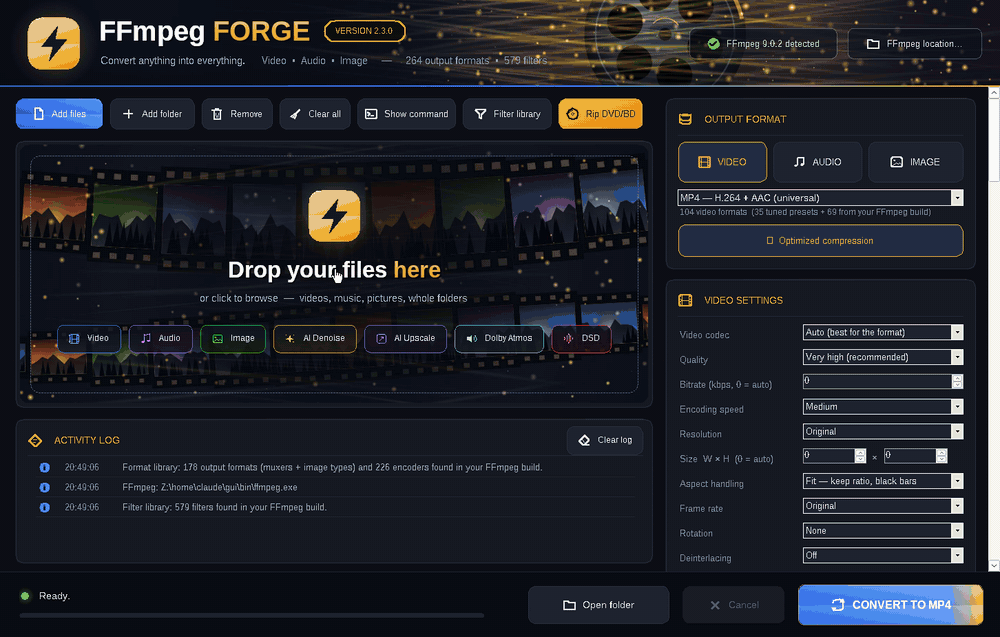
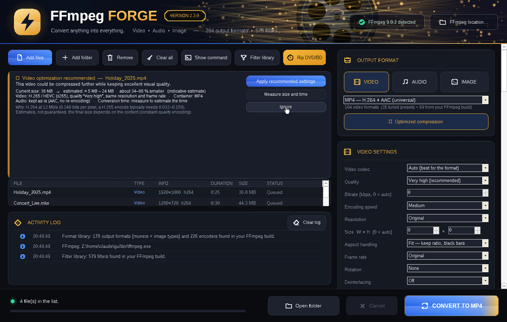
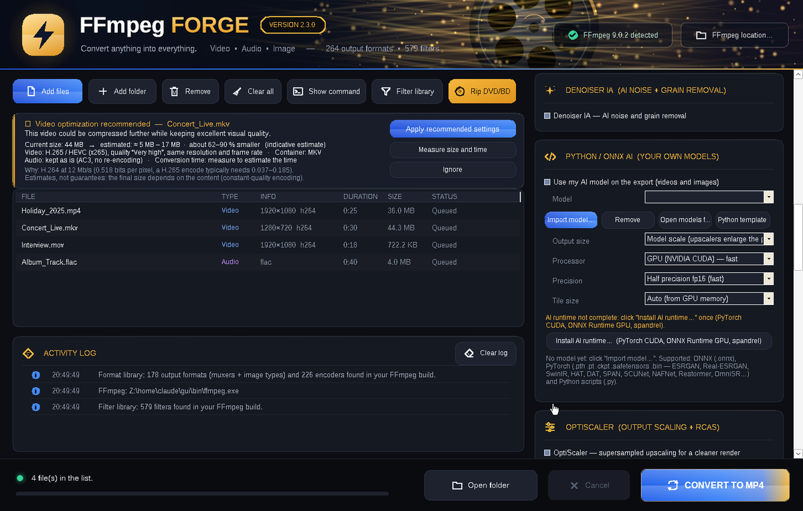
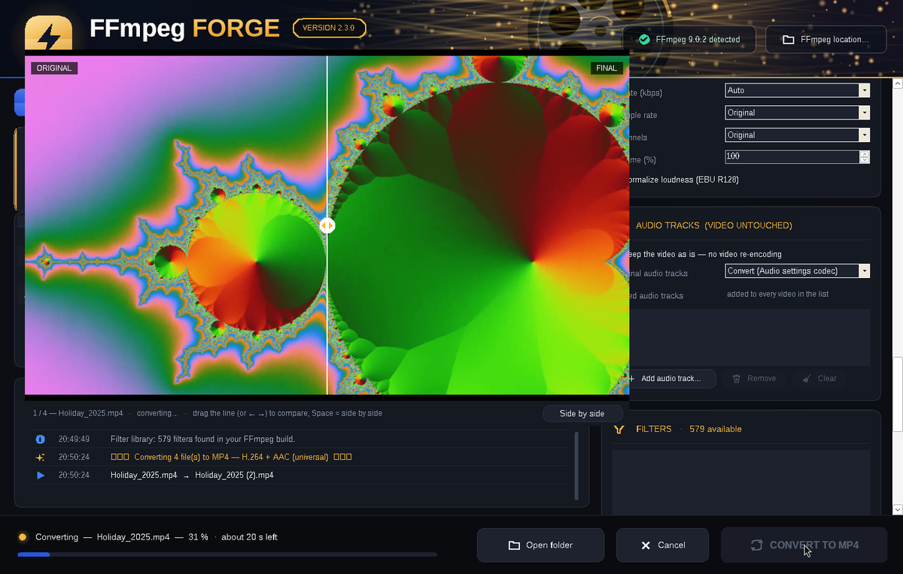
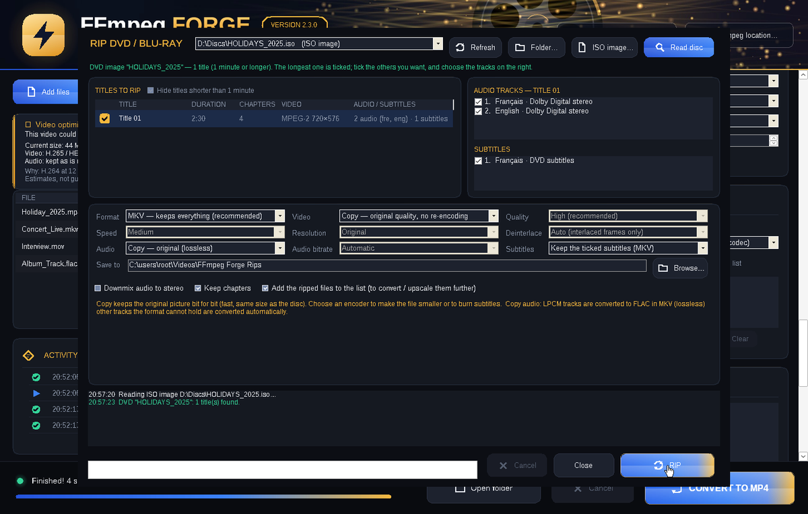

# FFmpeg Forge

**Convert anything into everything.** FFmpeg Forge is a portable Windows application that puts
the full power of FFmpeg behind one window: every format and codec of your FFmpeg build, GPU
upscalers, AI upscaling and denoising, SDR to HDR10 / Dolby Vision, immersive audio up to 22.2,
and a DVD / Blu-ray ripper. Version 2.3.0.



## Highlights

- **Every format of your FFmpeg build**: tuned presets first (MP4, MKV, MOV, WebM, ProRes 422 /
  4444 XQ, DNxHR, MP3, FLAC, Opus, AVIF, WebP...), then every muxer, image type and encoder read
  live from `ffmpeg.exe`. Formats with strict rules (DV, GXF, MXF D-10, AMV...) are fixed automatically.
- **Batch conversion** of files and whole folders, with a live before / after preview, progress
  and remaining time for every file, and an activity log. Originals are never overwritten.
- **Optimized compression**: each video is analysed and a smaller encode is suggested, with an
  estimate of the resulting size and time.
- **Scale**: FSR 1 / 2 / 3, NIS, SGSR, Anime4K, EWA Lanczos (GPU, libplacebo / Vulkan), xBR, hqx,
  Integer, Lanczos, Bicubic, Spline... plus the OptiScaler output stage (supersampling + RCAS).
- **AI upscale**: RazorNext (RelayVSR, temporal video super-resolution, native x4), VisionNext
  (VOSR 2.0), SeedVR2, NVIDIA RTX Video Super Resolution / TrueHDR, your own Python / ONNX models.
- **Denoiser**: AI denoiser (SCUNet, HAT, DAT, SPAN) with temporal stabilisation, or the Neat
  Video-style 3D FFT denoiser with automatic noise profile.
- **Deinterlacing**: QTGMC (VapourSynth) or FFmpeg bwdif, double or same frame rate.
- **HDR**: SDR to HDR10 or Dolby Vision 8.1, with dynamic metadata measured on every frame.
- **Immersive audio**: layouts up to 7.1.4, 9.1.6 and 22.2, an immersive upmix (spatial music,
  cinema, live concert), spatial audio for headphones, DSD (DSF / DFF), EBU R128 loudness.
- **Audio tracks**: change or add audio tracks without re-encoding the picture.
- **Rip DVD / Blu-ray**: disc drive, VIDEO_TS / BDMV folder or ISO image; titles, chapters,
  audio and subtitle languages; MKV copy or any video / audio format.
- **Filter library**: every FFmpeg filter of the build (570+ in a full build) with an automatic
  parameter editor, 45+ one-click recipes and a filtergraph editor for multi-input filters.

## Screenshots

| | |
| --- | --- |
|  |  |
| Main window: files, compression advisor, output format | Settings: Scale, SeedVR2, AI Upscale, Denoiser |
|  |  |
| Live before / after preview during a conversion | DVD / Blu-ray ripper |

## Download

Download `FFmpegForge-2.3.0-Portable.rar` from the [Releases](../../releases) page, extract it
anywhere (internal drive, external drive, USB stick) and start `FFmpegForge.exe`.
Nothing is installed and nothing is written to the registry: settings stay in the `Settings`
folder next to the program.

A Linux portable edition (`FFmpegForge-2.3.0-Linux-x86_64.tar.xz`, runs with Mono) and a
command-line edition (FFmpeg Forge CLI) are also available.

### Requirements

- Windows 10 / 11 64-bit with .NET Framework 4.x (built into Windows)
- GPU scaling (FSR, NIS, SGSR, Anime4K, OptiScaler): a Vulkan graphics driver
- NVENC, RTX Video and the AI engines: an NVIDIA GPU (16 to 24 GB of VRAM recommended for
  RazorNext, VisionNext and SeedVR2)

### Contents of the archive

| File / folder | Content |
| --- | --- |
| `FFmpegForge.exe` | FFmpeg Forge 2.3.0 |
| `bin\` | FFmpeg 9.0.2 full build (gyan.dev): ffmpeg, ffprobe, ffplay |
| `FFmpeg\` | FFmpeg licence, build information, documentation, presets |
| `ForgeRTX.exe` | NVIDIA RTX Video helper (RTX AI section) |
| `dovi_tool.exe` | Dolby Vision tool (MIT licence) for SDR to Dolby Vision 8.1 |
| `Source\` | source code and `build.bat` |
| `portable.txt` | portable mode (delete it to keep the settings in `%APPDATA%\FFmpegForge`) |

## Getting started

1. Drop files or whole folders into the window, or use **Add files** / **Add folder**.
2. Choose **VIDEO**, **AUDIO** or **IMAGE**, then the output format.
3. Adjust the settings if needed: codec, quality, resolution, frame rate, trimming, audio layout,
   Scale, Denoiser, AI Upscale, HDR...
4. Click **CONVERT**. The files are written next to the originals, or into the folder you chose.

**Show command** prints (and copies) the exact FFmpeg command line of the selected file.

## Features in detail

### Video

- Quality and speed presets, bitrate mode, NVENC constant quality
- Resolution presets (8K, DCI 4K, 4K, 1440p, 1080p, vertical 9:16, square...) or any size, with
  stretch, fit (black bars) or fill (crop)
- Frame rate, rotation and mirroring, trimming, subtitles kept
- Video to pictures (one frame, every frame, one frame every N seconds), PNG / JPG image
  sequences, picture to video, audio to animated waveform video
- Cover / thumbnail for MP4, M4V and MKV
- Stream copy for an instant, lossless change of container

### Scale and OptiScaler

Scale types: FSR 1 (AMD defaults), FSR 2 and FSR 3 (temporal, FSR 3 adds frame generation x2),
NIS, SGSR, Anime4K, xBR, hqx, Integer, Nearest neighbor, Sharp bilinear, BCAS, EWA Lanczos
Sharp, Lanczos, Bicubic, Spline. Factor x1.5 to x4 or the Resolution setting, sharpness,
GPU processing, screen-quality encode (10-bit, finer CRF) and full 4:4:4 chroma.

OptiScaler renders the picture larger than the output (x1.25 to x3), sharpens it with RCAS and
brings it back with Bicubic, Catmull-Rom, Lanczos 2 / 3, Kaiser 2 / 3 or Magic Kernel.

Open-source algorithms only: see `SHADER_LICENSES.txt`.

### AI engines

| Engine | What it does | Installation |
| --- | --- | --- |
| RazorNext | RelayVSR: temporal real-world video super-resolution, x1 to x4, stable detail from frame to frame | built in, "Install RazorNext model" (about 15 GB) |
| VisionNext | VOSR 2.0 one-step super-resolution, x1 to x8, tiles 256 / 512 | built in, "Install VisionNext model" (about 10 GB) |
| SeedVR2 | restoration and upscaling with the SeedVR2 models | built in, "Install SeedVR2" (about 4 GB) |
| AI denoiser | SCUNet, HAT, DAT, SPAN with temporal stabilisation | "Install AI runtime" |
| Python / ONNX | your own models (.onnx, .pth, .safetensors, .py) | "Install AI runtime" |
| NVIDIA RTX | RTX Video Super Resolution, RTX TrueHDR, DLSS (FFmpeg NGX build) | NVIDIA driver, ForgeRTX.exe |

The installers download Python, PyTorch and the official model weights into folders next to
`FFmpegForge.exe`; the models are not redistributed. RazorNext and VisionNext can also run
through an existing Visual Enhancer installation.

### HDR

SDR to HDR10 (PQ, BT.2020, 10-bit) or Dolby Vision 8.1 (HDR10 base layer and dynamic L1
metadata measured on every frame with dovi_tool), with a choice of peak brightness from 600 to
4000 nits. Pictures can be written as 16-bit PNG or 10-bit AVIF.

### Audio

- Layouts from mono to 7.1, Dolby Atmos / DTS:X beds (5.1.2, 5.1.4, 7.1.2, 7.1.4, 7.1.6,
  9.1.4, 9.1.6) and 22.2
- Immersive upmix: dialogue and lead vocal in the center, instruments kept in place, bass to the
  LFE, ambience to the wides and heights. Styles: Spatial Music, Music, Cinema, Live concert
- Spatial audio for headphones: the 7.1.4 mix rendered in 3D (measured HRTFs and a virtual room)
  into a normal stereo file
- Passthrough of existing Dolby Atmos (TrueHD / E-AC-3 JOC) and DTS:X tracks
- DSD output (DSF / DFF, DSD64 / DSD128), loudness normalisation (EBU R128), volume
- Audio tracks: keep the picture untouched and convert, keep or remove the existing audio, add
  tracks with language, title and delay

### DVD / Blu-ray ripper

**Rip DVD/BD** reads a disc drive, a VIDEO_TS / BDMV folder or an ISO image and lists the titles
(DVD) or playlists (Blu-ray) with their duration, chapters, audio tracks and subtitles. Choose
the titles and the tracks, then:

- Format: MKV, MP4, MOV, WebM, or audio only (FLAC, MP3, M4A, WAV, MKA)
- Video: copy (original quality), H.264, H.265, AV1, NVIDIA NVENC; quality, speed, maximum
  resolution, automatic deinterlacing for DVDs
- Audio: copy, AAC, AC-3, E-AC-3, FLAC, Opus, MP3; bitrate, downmix to stereo
- Subtitles: kept (MKV), removed, or burned into the picture; chapters kept

The ripped files can be added to the list for further conversion or AI upscaling.
Copy-protected discs (CSS, AACS, BD+) are not supported: FFmpeg Forge does not circumvent copy
protection and rips your own videos, home-made discs and discs without protection.

### Filters

The filter library lists every filter of your FFmpeg build with a search, categories and an
automatic parameter editor (drop-down lists, colour and file pickers, ranges, help). Timeline
filters can be limited to a time range. 45+ recipes are one click away (black and white, sepia,
sharpen, stabilize, crop 16:9 / 1:1 / 9:16, speed x2, slow motion, text watermark, bass boost,
karaoke, 8D audio, pitch shift...). Multi-input filters go into the filtergraph editor.

## Build from source

The source code is in `Source\`. FFmpeg Forge is written in C# 5 for .NET Framework 4 with
Windows Forms and has no external dependencies.

```text
Source\build.bat      rebuilds FFmpegForge.exe with the C# compiler shipped with Windows
```

`ForgeRTX.exe` is built from `Source\rtxhelper\ForgeRTX.c` with MinGW-w64.

## Version history

| Version | Main changes |
| --- | --- |
| 2.3.0 | DVD / Blu-ray ripper with titles, tracks, languages, chapters and format choices |
| 2.2.0 | RazorNext (RelayVSR) AI upscale for video and pictures, model choice in AI Upscale |
| 2.1.6 | New design, SDR to HDR10 / Dolby Vision 8.1, audio tracks without re-encoding the picture |

## License

FFmpeg Forge is released under the GNU General Public License v3.0 (`LICENSE-GPL-3.0.txt`).
Embedded shaders and HRTF data are listed in `SHADER_LICENSES.txt`. FFmpeg (GPL build by
gyan.dev), dovi_tool (MIT), RelayVSR, VOSR, SeedVR2 and SCUNet (Apache-2.0) keep their own
licences. Lossless Scaling's proprietary LS1 scaler is not included.
